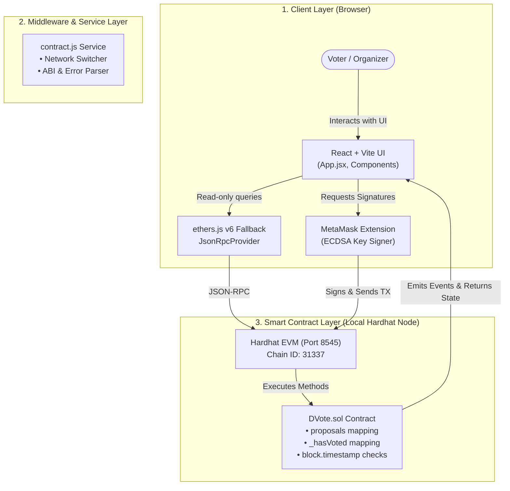

# 📖 dVote — Comprehensive User Manual & Technical Guide

> **Project**: dVote (Decentralized Governance & Voting System)  
> **Submission**: Google Developer Groups (GDG) On-Chain Web3 Recruitment Task  
> **Stack**: Solidity `^0.8.20`, Hardhat `2.22.x`, ethers.js `v6`, React 18, Vite  

---

## 📑 Table of Contents
1. [What is dVote?](#1-what-is-dvote)
2. [Why dVote? (The Problem & The Web3 Solution)](#2-why-dvote-the-problem--the-web3-solution)
3. [System Architecture & How It Works](#3-system-architecture--how-it-works)
4. [Step-by-Step User Guide (How to Use dVote)](#4-step-by-step-user-guide-how-to-use-dvote)
5. [Smart Contract Mechanics & Security Guarantees](#5-smart-contract-mechanics--security-guarantees)
6. [Recruitment Interview Preparation (Q&A Guide)](#6-recruitment-interview-preparation-qa-guide)

---

## 1. What is dVote?

**dVote** is an open, transparent, and immutable decentralized voting application (dApp). It enables communities, student clubs, and organizations to create proposals and vote on them directly on the Ethereum blockchain without relying on a centralized database, administrator, or back-end server.

### Core Capabilities
- **Decentralized Proposal Creation**: Anyone with a connected Web3 wallet can submit a proposal with a custom voting window (e.g. 1 hour, 3 days).
- **On-Chain Ballot Casting**: Wallets can cast either a **YES** or **NO** vote directly through a signed Ethereum transaction.
- **Strict Single-Vote Invariant**: Every wallet can cast exactly one vote per proposal. Duplicate voting is mathematically and programmatically prevented by Solidity logic.
- **Tamper-Proof Deadline Enforcement**: Once the proposal deadline passes on the blockchain, the contract permanently rejects any further votes.
- **Zero-Backend Architecture**: There is no SQL/NoSQL database, Node.js API server, or centralized intermediary. The Ethereum blockchain acts as the single source of truth.

---

## 2. Why dVote? (The Problem & The Web3 Solution)

### The Problem with Traditional Web2 Voting
Traditional digital voting systems (Google Forms, campus portals, centralized voting apps) suffer from fundamental vulnerabilities:
1. **Centralized Authority & Trust**: An administrator or server host has direct root/database access and can modify vote tallies, delete proposals, or alter timestamps.
2. **Lack of Verifiable Auditability**: Participants cannot independently verify that their votes were counted without trusting the system's claims.
3. **Single Point of Failure**: If the central database server goes down or is compromised, the entire voting process halts or becomes vulnerable to manipulation.
4. **Opaque Deadlines**: Administrators can arbitrarily extend or close deadlines at will.

### The Web3 Solution: Why dVote Wins
| Factor | Traditional Web2 Voting (Forms / DB) | dVote (Ethereum / Solidity) |
| :--- | :--- | :--- |
| **Data Storage** | MySQL / MongoDB (Editable by admin) | Ethereum Ledger (Immutable, append-only) |
| **Trust Model** | Trust the server administrator | **Trustless**: Verified by smart contract rules |
| **Voter Verification** | Email or login password (easily spoofed) | Cryptographic ECDSA signature via MetaMask |
| **Auditability** | Private server logs | Public, verifiable on-chain events (`Voted`, `ProposalCreated`) |
| **Deadline Control** | Server system clock (can be changed) | Consensus-enforced `block.timestamp` |
| **Duplicate Prevention**| Central software checks | Deterministic smart contract storage mapping |

---

## 3. System Architecture & How It Works

dVote consists of three decoupled layers:



### The End-to-End Workflow

#### Phase A: Proposal Creation
1. The user fills out the proposal title, description, and voting duration (e.g. 24 hours) in the React UI.
2. The UI calculates the duration in seconds and prompts MetaMask to call `createProposal(title, description, durationInSeconds)`.
3. The user signs the transaction in MetaMask.
4. The EVM executes `DVote.sol`:
   - Validates that `bytes(title).length > 0` and `duration > 0`.
   - Calculates `deadline = block.timestamp + duration`.
   - Increments `proposalCount` and stores a new `Proposal` struct.
   - Emits the `ProposalCreated` event.
5. The frontend detects the mined transaction, updates the proposal feed, and displays the new card.

#### Phase B: Voting
1. A connected user clicks **Vote YES** or **Vote NO** on an active proposal.
2. The UI invokes `vote(proposalId, choice)` through the signer.
3. MetaMask prompts the user to confirm gas and signature.
4. The smart contract validates three assertions:
   ```solidity
   require(_proposalId > 0 && _proposalId <= proposalCount, "Invalid proposal ID");
   require(block.timestamp < proposal.deadline, "Voting deadline has passed");
   require(!_hasVoted[_proposalId][msg.sender], "Address has already voted on this proposal");
   ```
5. If valid, the contract:
   - Marks `_hasVoted[proposalId][msg.sender] = true`.
   - Records `_voterChoice[proposalId][msg.sender] = choice`.
   - Increments either `proposal.yesVotes` or `proposal.noVotes`.
   - Emits the `Voted` event.
6. The frontend automatically re-queries the contract and updates the vote counter and visual progress bar.

---

## 4. Step-by-Step User Guide (How to Use dVote)

### Step 1: Connecting Your Wallet
1. Open dVote in your browser (e.g., `http://localhost:5173`).
2. Click **Connect MetaMask** in the top-right navbar.
3. Approve the connection request in the MetaMask pop-up.
4. Once connected, your wallet address (truncated, e.g. `0xf39F...2266`) and ETH balance will appear in the navbar.

### Step 2: Configuring the Network
- dVote operates on the local **Hardhat Network (Chain ID: 31337)**.
- If your wallet is connected to Ethereum Mainnet or a testnet (e.g., Sepolia), an alert banner will notify you.
- Simply click **Switch to Hardhat Localhost** to automatically switch networks.
- If the network is not yet in MetaMask, enter the details:
  - **Network Name**: `Hardhat Localhost`
  - **RPC URL**: `http://127.0.0.1:8545`
  - **Chain ID**: `31337`
  - **Currency Symbol**: `ETH`

### Step 3: Submitting a Proposal
1. Click **+ New Proposal** in the navbar or top toolbar.
2. In the modal:
   - Enter a **Title** (required, e.g., "Fund GDG Web3 Hackathon Prizes").
   - Enter a **Description** (optional context and details).
   - Select a **Voting Duration** (select between Minutes for testing, or Hours/Days).
   - Review the calculated deadline date and time.
3. Click **Create Proposal** and confirm the transaction in MetaMask.
4. When the transaction confirms, the new proposal card will immediately appear.

### Step 4: Casting a Vote
1. Browse the proposals feed. You can use the search bar or filter tabs:
   - **All**: Displays all historical and ongoing proposals.
   - **Active**: Shows only proposals currently open for voting.
   - **Closed**: Shows proposals whose deadlines have elapsed.
   - **My Votes**: Shows proposals in which your wallet participated.
2. On any **Active** proposal card:
   - Click **Vote YES** (Emerald button) or **Vote NO** (Rose button).
   - Confirm the transaction in MetaMask.
3. Once confirmed:
   - The card will reflect your vote (`You voted YES` or `You voted NO`).
   - The YES/NO count and dual-color progress bar will update.
   - The voting buttons will automatically disable to prevent duplicate voting.

---

## 5. Smart Contract Mechanics & Security Guarantees

### Key Security Implementations

#### 1. Per-Proposal Voter Isolation
Instead of a global array or single mapping, `DVote.sol` employs a two-dimensional mapping:
```solidity
mapping(uint256 => mapping(address => bool)) private _hasVoted;
```
- **Security Guarantee**: Voter state on Proposal #1 has zero impact on Proposal #2. An address can vote once on every distinct proposal.

#### 2. Strict Checks-Effects-Interactions
The contract follows the secure EVM checks-effects pattern:
```solidity
// 1. Checks
require(block.timestamp < proposal.deadline, "Voting deadline has passed");
require(!_hasVoted[_proposalId][msg.sender], "Address has already voted on this proposal");

// 2. Effects
_hasVoted[_proposalId][msg.sender] = true;
_voterChoice[_proposalId][msg.sender] = _choice;
if (_choice) proposal.yesVotes++;
else proposal.noVotes++;

// 3. Interactions / Events
emit Voted(_proposalId, msg.sender, _choice, proposal.yesVotes, proposal.noVotes);
```
State flags are set *before* counting or external calls, completely removing reentrancy vectors.

#### 3. Single-RPC Read Efficiency
Solidity's default public mapping getters only allow fetching a single item by key. To eliminate $N$ client network round-trips, `getAllProposals()` aggregates the entire list into an in-memory array:
```solidity
function getAllProposals() external view returns (Proposal[] memory) {
    Proposal[] memory allProposals = new Proposal[](proposalCount);
    for (uint256 i = 1; i <= proposalCount; i++) {
        allProposals[i - 1] = proposals[i];
    }
    return allProposals;
}
```
This enables the frontend to fetch 100% of proposals in one HTTP JSON-RPC request.

---

## 6. Recruitment Interview Preparation (Q&A Guide)

### Q1: Why did you use `block.timestamp` for deadlines instead of block numbers?
**Answer**:
> "Block numbers depend on network block creation intervals, which can vary or change during network upgrades. For a human-facing application, users think in real-world time (e.g., 'voting closes in 24 hours'). `block.timestamp` provides unix-epoch second resolution. While miners/validators have a tiny leeway of a few seconds (the 15-second rule), this variance is negligible for governance deadlines that span hours or days."

### Q2: How do you prevent a user from voting twice?
**Answer**:
> "We enforce duplicate prevention at the Solidity level using `mapping(uint256 => mapping(address => bool)) private _hasVoted`. Before incrementing vote counters, we run `require(!_hasVoted[proposalId][msg.sender])`. Once executed, `_hasVoted[proposalId][msg.sender]` is set to `true`. Any subsequent transaction from that address on the same proposal will revert and forfeit gas without modifying state."

### Q3: Why is ethers.js v6 used instead of Web3.js?
**Answer**:
> "Ethers.js v6 is modern, lightweight, strongly-typed, and provides native JavaScript `BigInt` support rather than legacy BigNumber wrappers. Its separation between `BrowserProvider` (for reading and MetaMask connection) and `Signer` (for signing transactions) makes state management in React clean and predictable."

### Q4: How does your frontend work if the user does NOT have MetaMask installed?
**Answer**:
> "We implemented a decoupled fallback provider in `contract.js`. If `window.ethereum` is unavailable, we instantiate `new ethers.JsonRpcProvider('http://127.0.0.1:8545')`. This allows anyone to view proposals, tallies, and deadlines without having MetaMask installed. MetaMask is only required when the user wants to sign a transaction (create a proposal or cast a vote)."

### Q5: How did you test deadline expiration in automated tests?
**Answer**:
> "In `test/DVote.test.js`, we used `@nomicfoundation/hardhat-network-helpers` and its `time.increase(3601)` helper. This sends the `evm_increaseTime` and `evm_mine` RPC methods to our local Hardhat node, advancing the blockchain timestamp past the deadline without waiting in real time, and verifying that the contract reverts with `'Voting deadline has passed'`."

